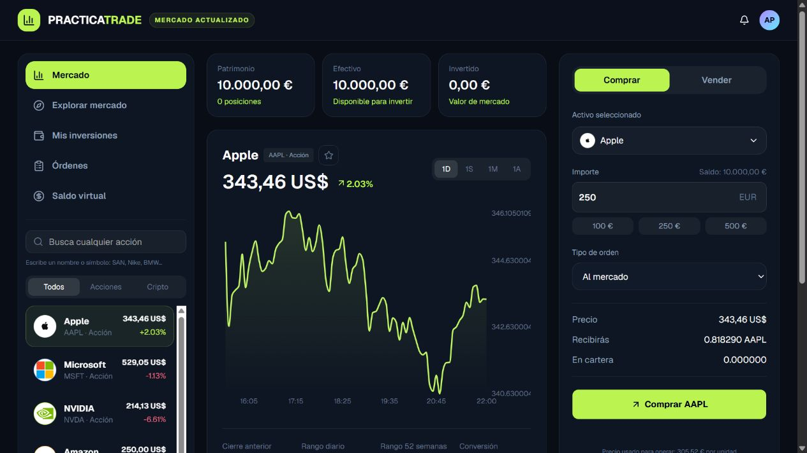

# PracticaTrade

**Explore stocks and crypto, practice trades with virtual money, and track your portfolio.**

[**Try the live demo →**](https://practicatrade-simulador.alejandrolillorod-al.chatgpt.site)

An educational trading simulator built as a hands-on learning project. Start with **€10,000 in virtual funds**, explore assets, and see how simulated trades affect your cash and holdings. The application interface is in Spanish.



## See it in action

The walkthrough below shows the market dashboard, a simulated purchase, and the resulting portfolio.


## Try it in one minute

1. Open the [live demo](https://practicatrade-simulador.alejandrolillorod-al.chatgpt.site).
2. Select an asset in **Mercado**.
3. Enter a virtual amount, such as **€250**, and keep **Al mercado** selected.
4. Click **Comprar**, then open **Mis inversiones** to inspect your position.
5. Reload the page: your practice portfolio is saved in this browser.

No account, payment details, or real funds are required.

## Features

- Stock and cryptocurrency catalog, with asset search.
- Simulated market purchases and sales.
- Cash balance, open positions, average purchase price, and portfolio performance.
- Market charts with multiple time ranges.
- Asset watchlist and market exploration.
- Virtual deposits, withdrawals, and simulation reset.
- Pending-order creation and cancellation for limit, stop-loss, and take-profit orders.
- Browser-local persistence of portfolio and preferences.
- Responsive layout with mobile navigation.

## Technology

- **TypeScript & React** for the application.
- **Vinext & Vite** for development and builds.
- **Tailwind CSS & shadcn/ui** for the interface.
- **Recharts** for charts.
- A server-side market endpoint fetching data from **Yahoo Finance**.
- **localStorage** for browser-local simulation data.

## Run locally

Requires **Node.js 22.13 or later** and npm.

```bash
git clone https://github.com/alejandrolillorodriguez1/practicatrade.git
cd practicatrade
npm ci
npm run dev
```

Open the local URL printed by the development server.

```bash
npm run build
```

Creates the production build. Market data requires access to the external provider.

## Learning focus

This project explores third-party API integration, interactive charts, React state management, currency conversion, portfolio calculations, and browser persistence.

## Current limitations

- Educational simulation only: no brokerage connection or real trades.
- Quotes can be delayed, cached, or unavailable. The interface includes fallback prices; charts may use illustrative fallback data when historical data is unavailable.
- Pending advanced orders can be created and cancelled, but automatic execution when the target is reached is not implemented.
- Simulation data stays in the current browser; there is no account synchronization.
- The simulator does not model fees, slippage, or taxes.

## Feedback welcome

Try a simulated purchase and inspect the portfolio. Is the relationship between cash, invested value, and performance clear?

[Report a bug or suggest an improvement](https://github.com/alejandrolillorodriguez1/practicatrade/issues).

For bug reports, include your browser, steps to reproduce, and the expected result. Contributions are welcome; please discuss larger changes in an issue first.

## License

[MIT](LICENSE)
